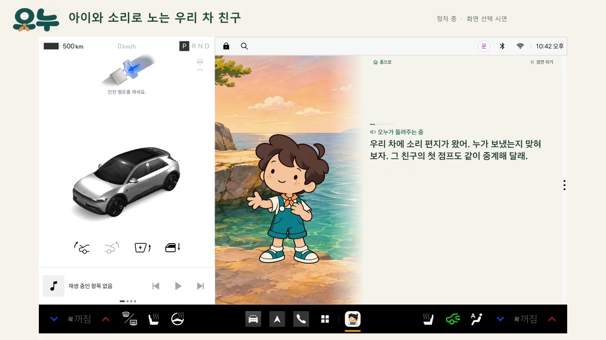

# 오누

아이와 오누가 차 스피커에서 들리는 소리를 맞히고, 그 답으로 다음 여행의 이야기를 만드는 한국어 차량용 앱입니다.

## 설치

Pleos Connect 2.1.0 에뮬레이터(Android 14)에서 정차 상태로 실행합니다. [서명 APK](apk/오누_오누_release.apk)를 설치하고 앱 목록에서 오누를 엽니다. 기존 release를 쓰고 있다면 같은 앱에 업데이트할 수 있습니다. 개발용 demo와 debug는 별도 앱입니다.

Android SDK의 adb를 쓰는 경우 `adb install -r "apk/오누_오누_release.apk"`로 설치합니다. 에뮬레이터는 가상 마이크 없이 화면 선택으로 두 편을 끝까지 체험할 수 있습니다. 음성 이용은 Pleos 한국어 음성 서비스와 마이크 권한을 필요로 합니다.

## 첫 편에서 답장까지

1. 처음 여는 가족은 별명을 정하고 관심사에서 바다를 고릅니다. 마이크가 꺼진 에뮬레이터에서는 ‘듣고 선택하기’를 고릅니다. 오누의 대사와 효과음이 끝나기를 기다린 뒤 화면에서 답할 수 있습니다.
2. 홈에서 ‘첫 점프를 들려줘!’를 엽니다. 물소리를 듣고 동물을 추측해 보세요. ‘깃털이 있어?’라는 질문으로 한 번 더 확인한 뒤 ‘성큼성큼, 작게 퐁당!’을 고르면 아이가 정한 점프가 중계됩니다.
3. 중계를 끝까지 들으면 첫 편의 마지막 화면과 홈에서 펭귄의 답장을 열 수 있습니다. 오누가 아이가 고른 점프를 떠올립니다. 빗방울과 와이퍼를 알아맞히고, 처음과 나중에 소리가 얼마나 촘촘해지는지 들어 보세요.
4. ‘톡톡 먼저’로 곡을 듣고 ‘다른 순서로 듣기’에서 ‘슥삭 먼저’를 골라 보세요. 두 곡은 첫 두 박자부터 다릅니다. 중간에 ‘잠깐 쉬기’를 누르면 다음 정차에서 그 문제로 돌아옵니다.

게임을 끝낸 뒤 보호자 설정의 기록에서 두 편을 다시 찾을 수 있습니다. 완성한 방송 음악에는 어느 소리를 먼저 골랐는지도 남습니다.

[시연 MP4](video/오누_차량화면_시연.mp4) · [브라우저용 WebM](video/onu-preview.webm) · [빌드와 시연 검증 기록](verification.json) · [파일 해시](SHA256SUMS.txt)

## 소스에서 실행

JDK 17, Android SDK Platform 35와 Android SDK Build Tools를 설치합니다. `apps/vehicle`에서 Windows는 `gradlew.bat :app:assembleDemo`, macOS·Linux는 `bash gradlew :app:assembleDemo`를 실행합니다. 최초 빌드는 Gradle과 의존성을 내려받도록 인터넷 연결이 필요합니다. APK는 `app/build/outputs/apk/demo/`에 생성됩니다. 심사용 서명 파일은 위 설치 링크에 별도로 제공합니다.

게임은 정차 중에 이용합니다. 운행 제한이 들어오면 놀이와 입력을 쉬고, 다음 정차에서 직접 이어갑니다. 에뮬레이터에서 화면 선택으로 한 시연이며, 실차 내 아동 발화 인식은 별도 검증 대상입니다. [앱의 소리와 구성요소 출처](SOURCES.md)

